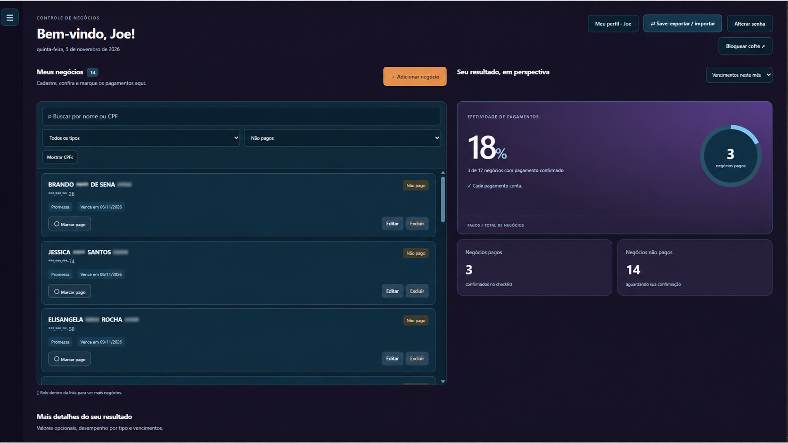
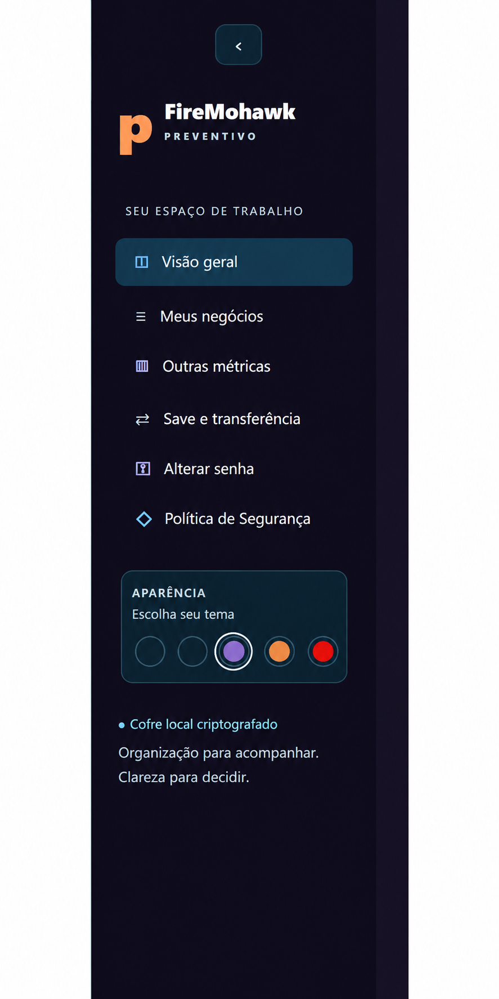
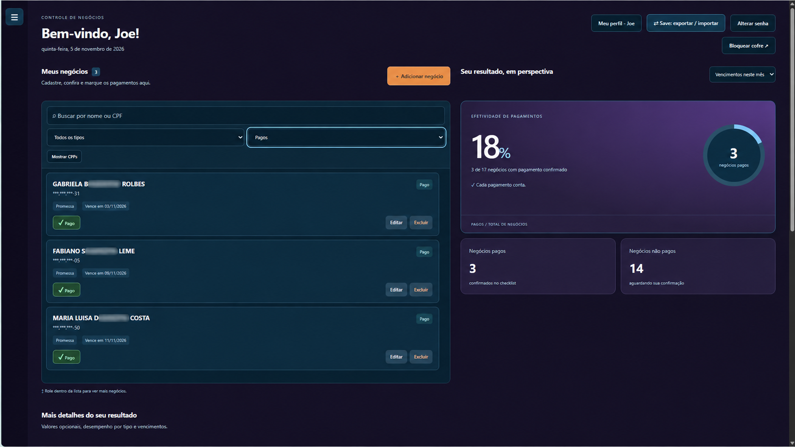
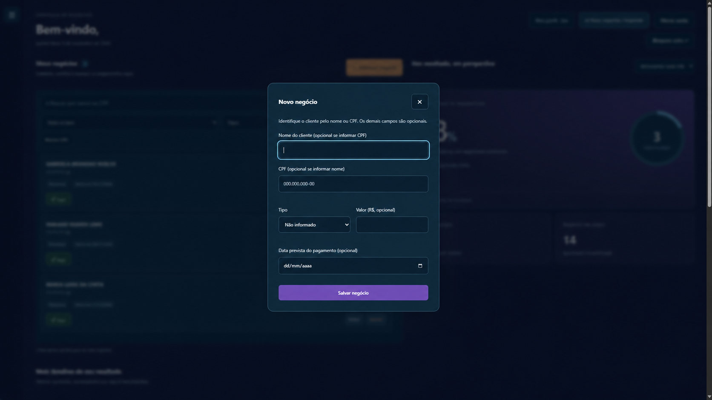
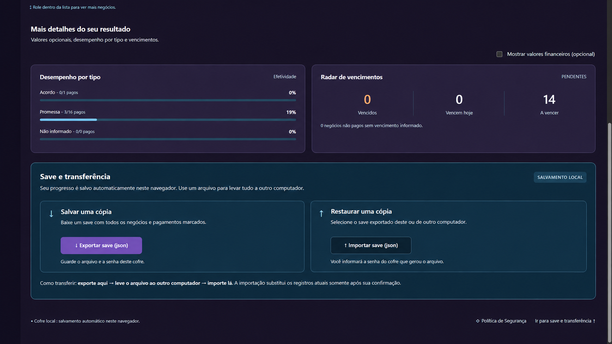
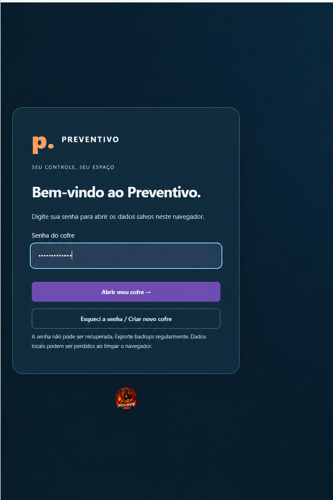
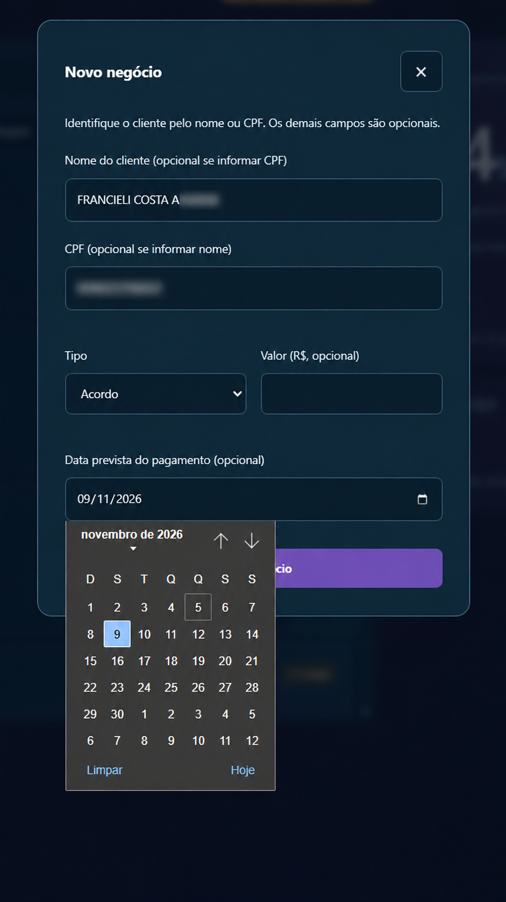
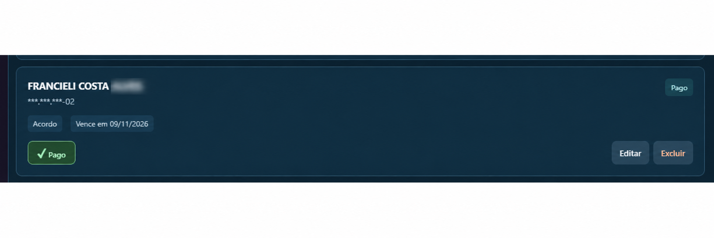
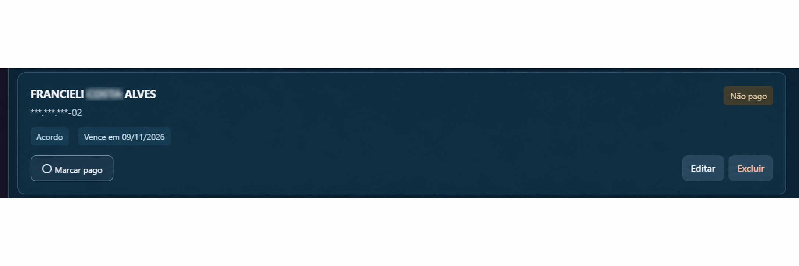

# Preventivo — galeria da interface

Selecionei dez capturas de uma versão anterior às revisões R2–R4. Não apresento estas imagens como evidência visual da R4. Utilizei os dez PNGs já editados que selecionei para divulgação, sem novas edições, redimensionamento ou recompressão.

Os indicadores representam os registros exibidos; a confirmação de pagamento é manual e não constitui comprovação financeira.

## Dashboard de pendentes

Organizei os negócios pendentes com filtros, prazos e indicadores para facilitar minha consulta diária.

## Menu lateral

Reuni a navegação e a escolha de temas em um menu lateral para tornar o acesso às funções mais direto.

## Dashboard de pagos

Separei os registros confirmados manualmente como pagos e mantive os indicadores visíveis durante a consulta.

## Cadastro vazio

Desenvolvi um formulário com campos opcionais para registrar as informações disponíveis de cada negociação.

## Métricas e backup

Agrupei os indicadores por tipo, o radar de vencimentos e as opções de exportação e importação do cofre.

## Cofre de acesso

Apresentei o acesso ao cofre local por senha e incluí orientações sobre a importância dos backups.

## Conquista desbloqueada

Incluí um feedback de conquista para acompanhar a confirmação manual de um negócio pago.

## Cadastro protegido

Organizei o preenchimento e a seleção de data; nesta captura, protegi os dados pessoais para apresentar o fluxo.

## Cartão pago

Diferenciei visualmente o cartão após a confirmação manual de pagamento, mantendo as ações de edição e exclusão.

## Cartão não pago

Destaquei o estado pendente, o vencimento e a ação de marcar como pago em um cartão de consulta rápida.

