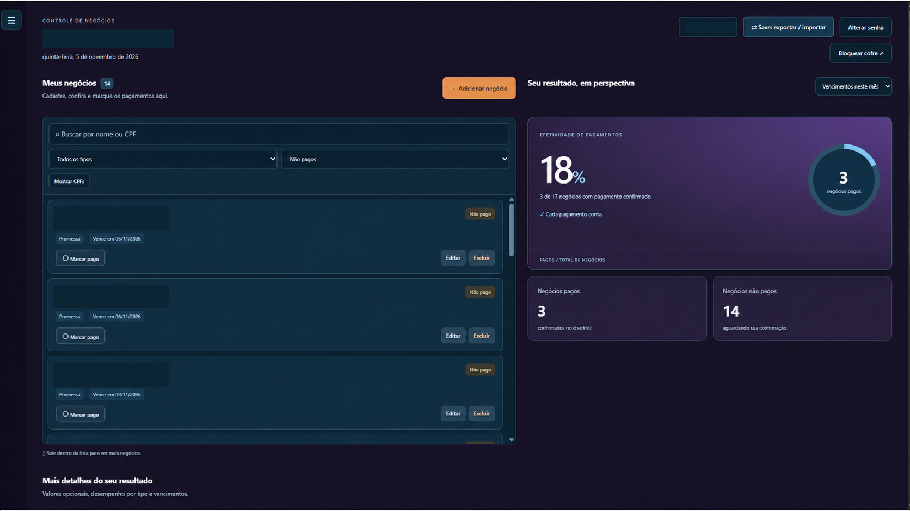
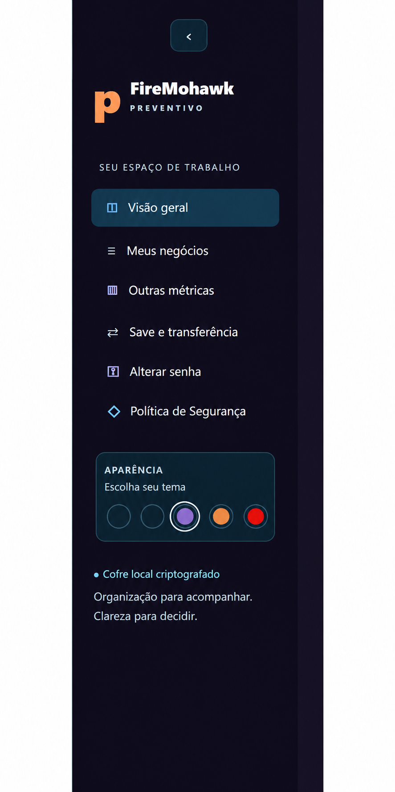
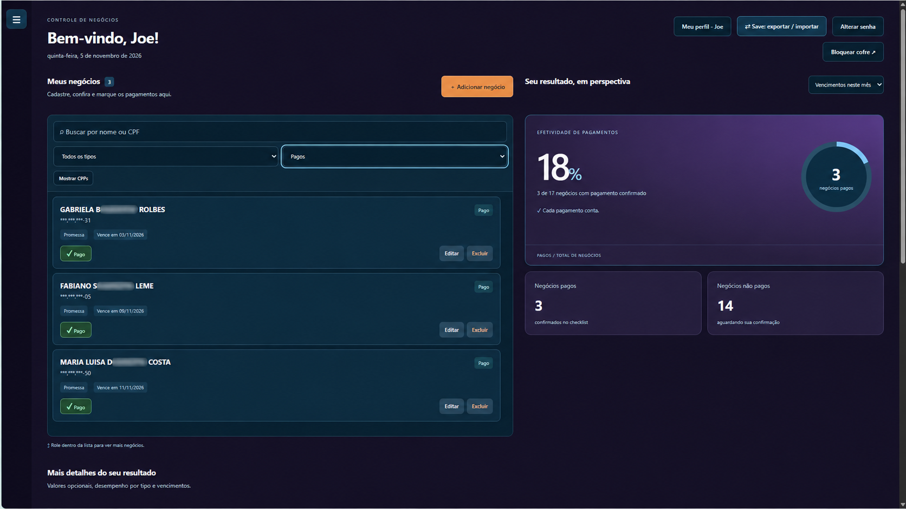
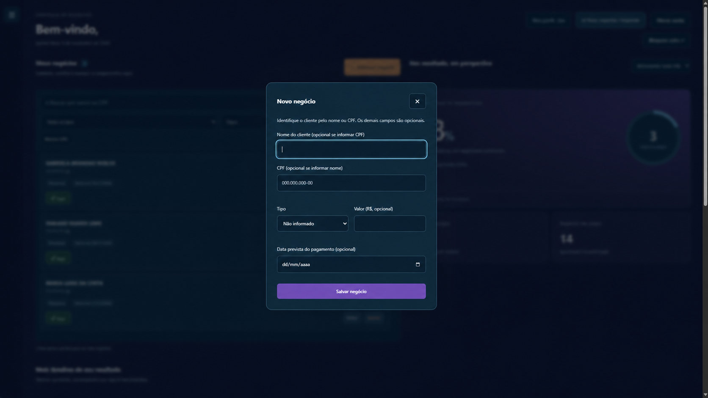
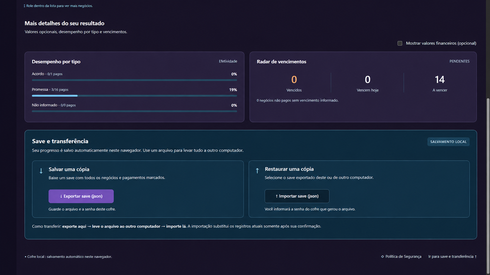
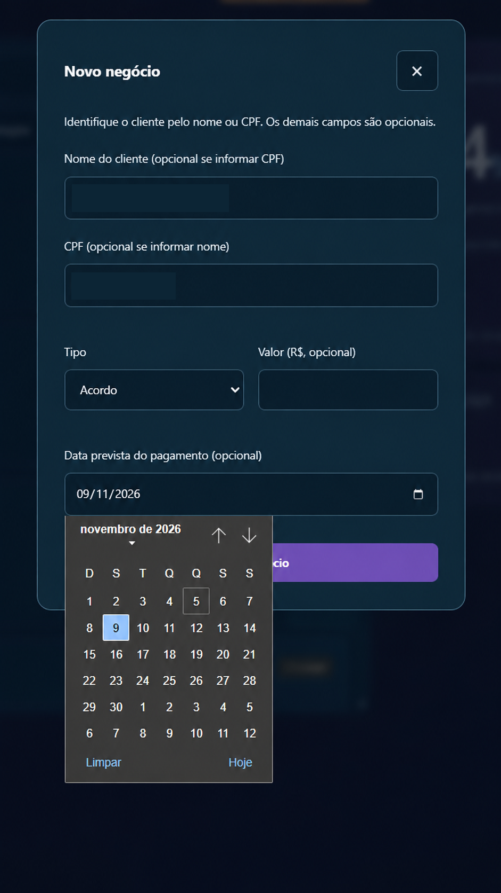
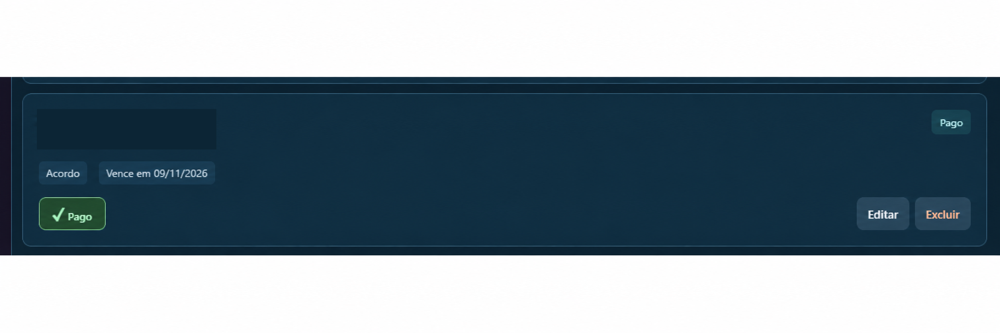
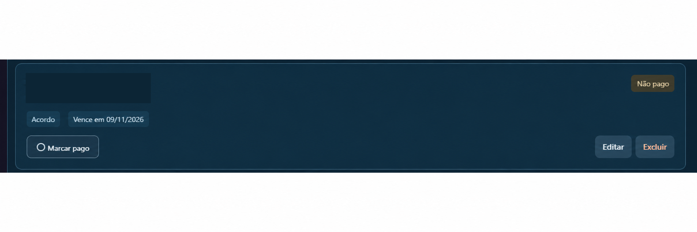

# Preventivo — telas, funcionalidades e experiência de uso

**Estudo de caso visual e funcional | Aplicação web desenvolvida com apoio de GPT/Codex**

Criei o Preventivo para acompanhar negociações em um fluxo de atendimento que exige consultas rápidas, organização de prazos e visualização de resultados. As telas documentadas abaixo mostram como transformei essa necessidade em uma aplicação web utilizável no dia a dia.

> **Sobre as imagens:** selecionei dez capturas da interface de uma versão anterior às revisões R2–R4 e utilizei os PNGs já editados que forneci e autorizei para divulgação, sem nenhuma edição adicional. Publiquei os dez PNGs na pasta `imagens/`. Os dez arquivos publicados são cópias idênticas aos PNGs fornecidos, apenas renomeados. Os indicadores exibidos representam estados dos registros, não medições de produtividade da operação.

## Navegação pela galeria

Organizei as dez capturas abaixo para mostrar os fluxos do produto. Os links levam às respectivas imagens na própria galeria; os prints representam uma versão anterior à 2.0.1.

| Imagem | Funcionalidade apresentada |
| --- | --- |
| [1. Dashboard de pendentes](#dashboard-de-pendentes) | Busca, filtros, prazos e indicadores |
| [2. Menu lateral](#menu-lateral) | Navegação e personalização de temas |
| [3. Dashboard de pagos](#dashboard-de-pagos) | Negócios com pagamento confirmado manualmente |
| [4. Cadastro vazio](#cadastro-vazio) | Inclusão de nova negociação |
| [5. Métricas e backup](#métricas-e-backup) | Indicadores adicionais, exportação e importação |
| [6. Cofre de acesso](#cofre-de-acesso) | Proteção local por senha |
| [7. Conquista desbloqueada](#conquista-desbloqueada) | Feedback visual ao registrar pagamento |
| [8. Cadastro protegido](#cadastro-protegido) | Exemplo de preenchimento com dados editados |
| [9. Cartão pago](#cartão-pago) | Estado visual após confirmação |
| [10. Cartão não pago](#cartão-não-pago) | Estado pendente e ação de atualização |

As telas com registros documentam a interface e seus estados visuais; **não constituem comprovação financeira**. A confirmação de pagamentos é uma ação manual, realizada após consulta autorizada.

## Galeria de capturas publicadas

Selecionei dez capturas de uma versão anterior às revisões R2–R4. Não apresento estas imagens como evidência visual da R4. Utilizei os dez PNGs já editados que selecionei para divulgação, sem novas edições, redimensionamento ou recompressão.

Os indicadores representam os registros exibidos; a confirmação de pagamento é manual e não constitui comprovação financeira.

### Dashboard de pendentes

Organizei os negócios pendentes com filtros, prazos e indicadores para facilitar minha consulta diária.

### Menu lateral

Reuni a navegação e a escolha de temas em um menu lateral para tornar o acesso às funções mais direto.

### Dashboard de pagos

Separei os registros confirmados manualmente como pagos e mantive os indicadores visíveis durante a consulta.

### Cadastro vazio

Desenvolvi um formulário com campos opcionais para registrar as informações disponíveis de cada negociação.

### Métricas e backup

Agrupei os indicadores por tipo, o radar de vencimentos e as opções de exportação e importação do cofre.

### Cofre de acesso

Apresentei o acesso ao cofre local por senha e incluí orientações sobre a importância dos backups.

### Conquista desbloqueada

Incluí um feedback de conquista para acompanhar a confirmação manual de um negócio pago.

### Cadastro protegido

Organizei o preenchimento e a seleção de data; nesta captura, protegi os dados pessoais para apresentar o fluxo.

### Cartão pago

Diferenciei visualmente o cartão após a confirmação manual de pagamento, mantendo as ações de edição e exclusão.

### Cartão não pago

Destaquei o estado pendente, o vencimento e a ação de marcar como pago em um cartão de consulta rápida.

## 1. Cofre de acesso e proteção local

A tela de entrada apresenta o **cofre de dados**, protegido por senha. Como a aplicação foi projetada com uma abordagem *local-first*, os registros são mantidos no navegador, e a senha permite o acesso aos dados protegidos.

**O que demonstra:** atenção à privacidade, fluxo de autenticação local, mensagens de orientação e diferenciação entre dados locais e uma conta online. A própria interface alerta sobre a importância dos backups: uma senha perdida não pode ser recuperada pelo aplicativo.

## 2. Visão geral e dashboard de efetividade

Organizei a visão principal em duas áreas complementares: **lista de negócios** e **painel de indicadores**. À esquerda, é possível localizar e consultar registros; à direita, um dashboard apresenta a quantidade de negócios pagos e não pagos e a **taxa de efetividade**, com indicador circular.

**O que demonstra:** desenvolvimento de dashboard dinâmico, atualização automática de totais e percentuais a partir dos registros, apresentação visual de informações e foco na leitura rápida por quem utiliza a ferramenta.

A **confirmação de pagamento é manual**, após consulta ao sistema autorizado. O que se atualiza automaticamente são os gráficos, contadores e percentuais decorrentes dessa confirmação. O Preventivo não consulta contas, bancos ou sistemas corporativos para verificar pagamentos por conta própria.

## 3. Cadastro e classificação de negócios

Desenvolvi um formulário de cadastro com identificação do cliente, tipo de negociação, valor opcional e data prevista de pagamento. Os campos opcionais permitem registrar informações disponíveis sem exigir preenchimento desnecessário.

**O que demonstra:** formulários claros, classificação por tipo (**acordo** ou **promessa**), uso de seleção de datas e simplificação da entrada de dados.

## 4. Situação de pagamento e ação rápida

Cada cartão de negócio mostra dados essenciais, tipo, vencimento, estado do pagamento e ações de edição ou exclusão. Quando o usuário confirma um pagamento, a apresentação do cartão muda para distinguir visualmente **pago** e **não pago**.

**O que demonstra:** estados de interface coerentes, feedback visual imediato e integração entre ações do usuário e indicadores do dashboard.

## Anotações por bandeirinhas — histórico das revisões R2–R4

Nas revisões R2–R4, redesenhei o cabeçalho de cada cartão para incluir **bandeirinhas coloridas e personalizáveis**, usadas como atalhos para notas relacionadas a cada negociação. As bandeirinhas ficam na faixa superior central e o botão `+` permanece separado à direita.

O usuário pode **clicar em uma bandeirinha para ler a anotação no centro do próprio cartão**, escolher outra nota e editar por duplo clique ou botão específico; isso também favorece o uso por teclado e dispositivos de toque. As notas continuam vinculadas aos registros armazenados no cofre local criptografado. O limite documentado é de 12 bandeirinhas por negócio, com nove ícones e seis cores.

A revisão histórica **R4** preservou o preenchimento azul dos cartões em todos os temas — inclusive o vermelho — e aplicou um contorno luminoso discreto. **A base oficial mais recente é a 2.0.1**, aprovada em 6 de novembro de 2026; [documentei separadamente suas mudanças e seus testes](ATUALIZACAO-2.0.1.md).

**Para ver a evolução e os testes:** [estudo de caso R1–R4](EVOLUCAO-R1-R4.md) · [validação da R4](VALIDACAO-R4.md).

> **Sobre as capturas:** os dez prints editados documentam uma versão anterior às revisões R2–R4 e à atual 2.0.1. Não os apresento como evidência visual de funcionalidades ou elementos gráficos acrescentados depois. A evolução posterior está registrada em [histórico R1–R4](EVOLUCAO-R1-R4.md) e na [atualização 2.0.1](ATUALIZACAO-2.0.1.md).

## 5. Filtros, pesquisa e lista de negócios

A interface oferece busca por nome ou identificador e filtros de tipo e situação. Em listas extensas, o rolamento interno ajuda a manter o painel de indicadores acessível enquanto os registros são consultados.

**O que demonstra:** organização de informação, filtros de consulta e redução de etapas operacionais. Identificadores pessoais podem ser ocultados na apresentação da tela.

## 6. Desempenho por tipo e radar de vencimentos

A seção de métricas detalhadas mostra **percentuais de efetividade por tipo de negociação**, com barras de progresso, além de um **radar de vencimentos** que separa compromissos vencidos, com vencimento no dia e futuros.

**O que demonstra:** visualização de dados, segmentação de indicadores e análise de prazos em uma mesma experiência.

Esses gráficos representam o **estado dos registros da aplicação**, não estatísticas de desempenho da empresa ou resultados financeiros auditados.

## 7. Conquistas e feedback de interação

Criei mensagens de conquista que aparecem em situações específicas, como a confirmação de mais um negócio pago. A mensagem destaca o resultado registrado sem interromper permanentemente o fluxo de trabalho.

**O que demonstra:** microinterações, gamificação leve, feedback contextual e preocupação com a experiência de uso.

## 8. Exportação, importação e continuidade de trabalho

A seção **Save e transferência** permite exportar uma cópia protegida em arquivo JSON e importá-la em outro navegador ou equipamento mediante senha. A interface também apresenta orientações sobre a operação.

**O que demonstra:** portabilidade de dados, recuperação controlada, persistência local e explicações para operações sensíveis. O conteúdo não é sincronizado automaticamente em servidor público.

## 9. Navegação, organização e aparência

A aplicação possui menu lateral com acesso à visão geral, negócios, métricas, backups, senha e política de segurança, além de opções de tema visual.

**O que demonstra:** arquitetura da informação, navegação entre áreas da aplicação, consistência de componentes e personalização.

---

## Minha atuação no desenvolvimento

Identifiquei o problema na rotina profissional, defini as funcionalidades necessárias, acompanhei a implementação assistida por **GPT/Codex**, executei testes e utilizei feedback de outros profissionais para orientar melhorias. A IA foi uma **ferramenta de desenvolvimento**, não um sistema de decisão automatizada embutido no Preventivo.

Os dados permanecem armazenados localmente, e a transferência entre dispositivos depende da exportação e da importação manual de um backup criptografado. Não publico neste portfólio código interno, registros de clientes, CPF, nomes de usuários, backups ou dados da organização.

**Voltar ao [estudo de caso principal](README.md)** · [Entender a origem da solução](CONTEXTO-PROFISSIONAL.md)